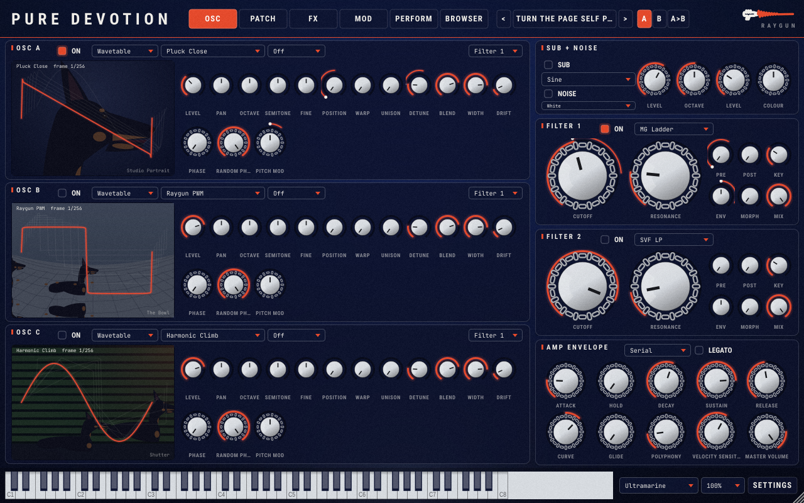

# Pure Devotion — by Raygun

Hybrid wavetable synthesizer and semi-modular patching instrument for live performance.
VST3 · AU · Standalone · macOS (Universal) · Windows (x64). JUCE 8 + CMake + C++20.



## Build

```bash
git clone --depth 1 --branch 8.0.9 https://github.com/juce-framework/JUCE.git external/JUCE   # optional: CMake fetches it otherwise
cmake -B build -DCMAKE_BUILD_TYPE=Release
cmake --build build --config Release --target PureDevotion_VST3 PureDevotion_Standalone PresetForge
```

On macOS, add `PureDevotion_AU` to the targets (the Xcode generator is recommended). For AAX, pass `-DPD_AAX_SDK_PATH=/path/to/aax-sdk`.

## Layout

| Path | Contents |
|---|---|
| `src/core` | Parameter table (~500 automatable params), mod matrix, lock-free state publishing |
| `src/dsp` | Wavetable bank (256 frames, mip-mapped), sample bank (synthesised factory content), voice, engine |
| `src/fx` | 16-effect rack, 2 parallel buses |
| `src/patch` | Modular PATCH interpreter (25 module types) |
| `src/perform` | Chord/arp/grooves, riser/drop, stutter/tape stop, vocal chop pad |
| `src/presets` | `.pdvo` format (versioned JSON), library/browser, procedural generator |
| `src/ui` | Themes, widgets, six tab pages, Two Dogs visualiser |
| `tools/PresetForge.cpp` | Content tool: generate + QA presets, export wavetables/samples/art, host test, benchmark |
| `content/Factory Presets` | 2,850 QA'd factory presets |
| `assets` | Fonts, logo, theme PNGs @1x/@2x, dog sprite sheets |
| `installers` | macOS `.pkg` and Windows Inno Setup scripts |
| `docs` | User manual (HTML + PDF) |

## PresetForge

```bash
PresetForge generate --out "content/Factory Presets"   # all 2,850, rendered and gain-staged (add --neutral-names for distributable names)
PresetForge render --preset X.pdvo --out x.wav
PresetForge export-wavetables --out content/Wavetables
PresetForge export-samples --out content/Samples
PresetForge export-art --out assets
PresetForge host-test --plugin "build/.../Pure Devotion.vst3"
PresetForge bench
```

## CI and release

`.github/workflows/build.yml` builds on `macos-15` and `windows-2022`. It then runs the preset QA smoke test, the VST3 host test and **pluginval at strictness 10** (VST3, plus AU on macOS). It exports content, packages each platform, and zips the results into `PureDevotion_v1.0.zip` (`/macOS/PureDevotion.pkg`, `/Windows/PureDevotion_Setup.exe`).

Signing and notarisation turn on when these repository secrets are set:
`MACOS_DEV_ID_APP`, `MACOS_DEV_ID_INSTALLER`, `MACOS_CERT_P12_BASE64`, `MACOS_CERT_PASSWORD`, `NOTARY_APPLE_ID`, `NOTARY_TEAM_ID`, `NOTARY_PASSWORD`, `WIN_CERT_PFX_BASE64`, `WIN_CERT_PASSWORD`. Without them the installers are built unsigned.

## Notes

- Preset names use real release titles (private build). Run `generate --neutral-names` before any distribution.
- Factory presets install to `/Library/Application Support/Raygun/Pure Devotion/Factory Presets` on macOS and `C:\ProgramData\Raygun\Pure Devotion\Factory Presets` on Windows. `PD_FACTORY_DIR` and `PD_USER_DIR` override these.
